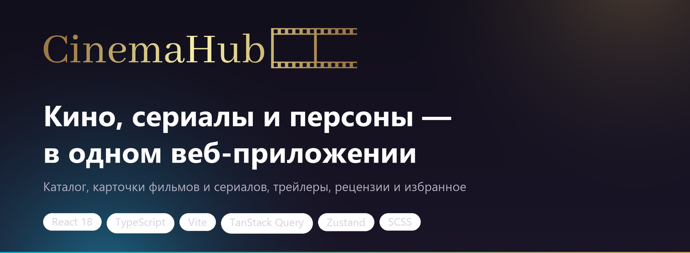

# CinemaHub

**Каталог фильмов и сериалов с карточками, трейлерами, рецензиями и избранным.**  
Многостраничное SPA на React и TypeScript: данные — Kinopoisk API Unofficial, интерфейс — тёмная тема с адаптивом под десктоп, планшет и смартфон.


---

## О проекте

CinemaHub — это приложение для тех, кто любит кино: здесь можно посмотреть новинки проката, отфильтровать каталог фильмов и сериалов, изучить карточку фильма с актёрами, трейлерами и рецензиями, заглянуть на страницу персоны и собрать собственное избранное.

Проект задуман как pet-проект для портфолио: помимо интерфейса, в нём есть архитектура, работа с внешним API, кэширование запросов, управление состоянием, формы с валидацией и адаптивная вёрстка.

**Что важно в проекте с точки зрения разработки:**

- данные приходят из внешнего API (Kinopoisk API Unofficial), а состояние запросов, кэш и обработка ошибок построены на TanStack Query;
- фильтры каталога и избранное вынесены в отдельные Zustand-сторы — панель фильтров и список карточек работают с одним источником состояния;
- страницы загружаются лениво (`React.lazy` + `Suspense`), production-сборка разбита на чанки;
- интерфейс перестраивается под три режима — `desktop`, `tablet`, `mobile` — по ширине окна;
- формы входа и регистрации сделаны на `react-hook-form` с валидацией email, пароля и телефона.

> Авторизация и избранное реализованы на клиенте (localStorage + cookie) — это осознанное упрощение, чтобы показать работу с состоянием без собственного бэкенда.

---

## Скриншоты

| Главная страница | Каталог фильмов |
| :---: | :---: |
| 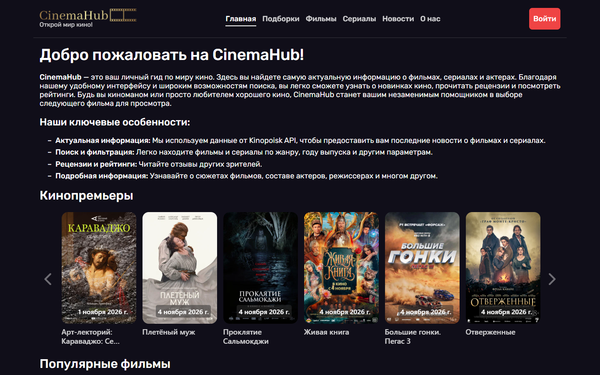 | 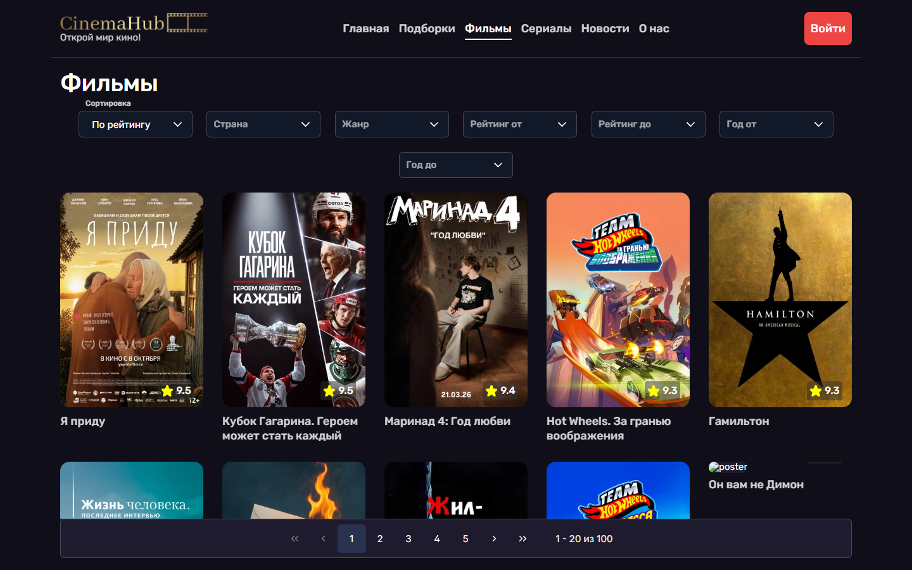 |
| Приветствие и карусели с новинками, популярными фильмами и сериалами | Фильтры, карточки с постерами и рейтингами, пагинация |

| Карточка фильма | Страница персоны |
| :---: | :---: |
| 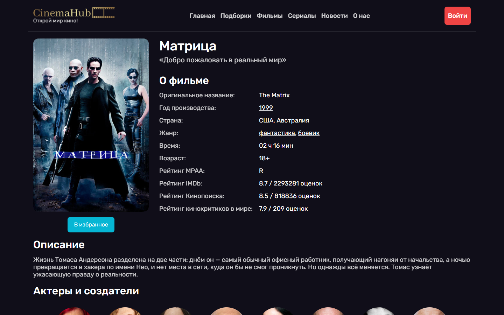 | 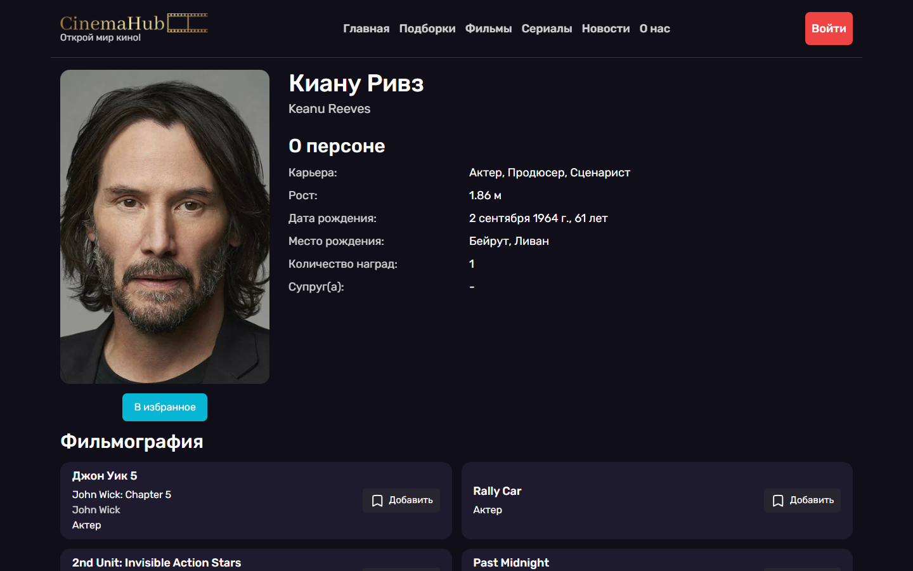 |
| Постер, характеристики, рейтинги и кнопка «В избранное» | Данные о персоне и фильмография |

| Личный кабинет | Регистрация |
| :---: | :---: |
| 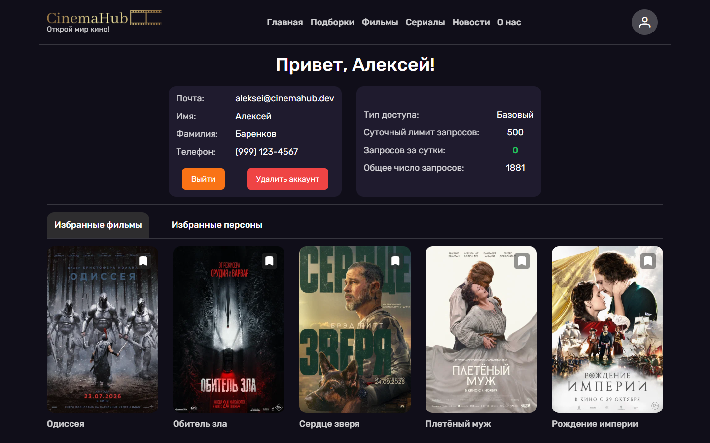 | 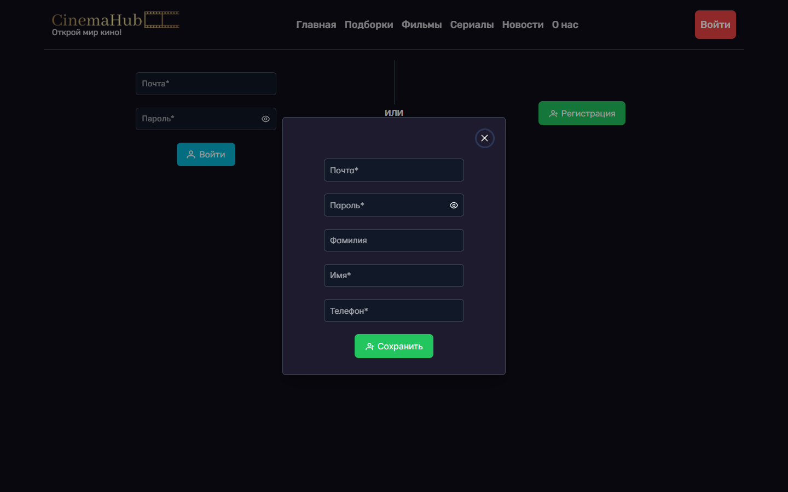 |
| Профиль, статус API-ключа и избранные фильмы | Модальное окно регистрации с валидацией полей |

| Подборки | Новости |
| :---: | :---: |
| 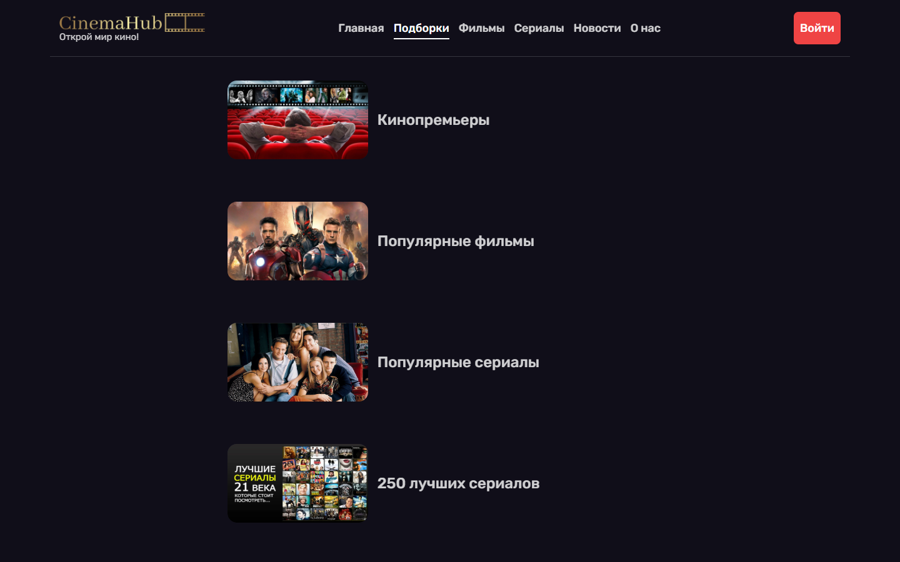 | 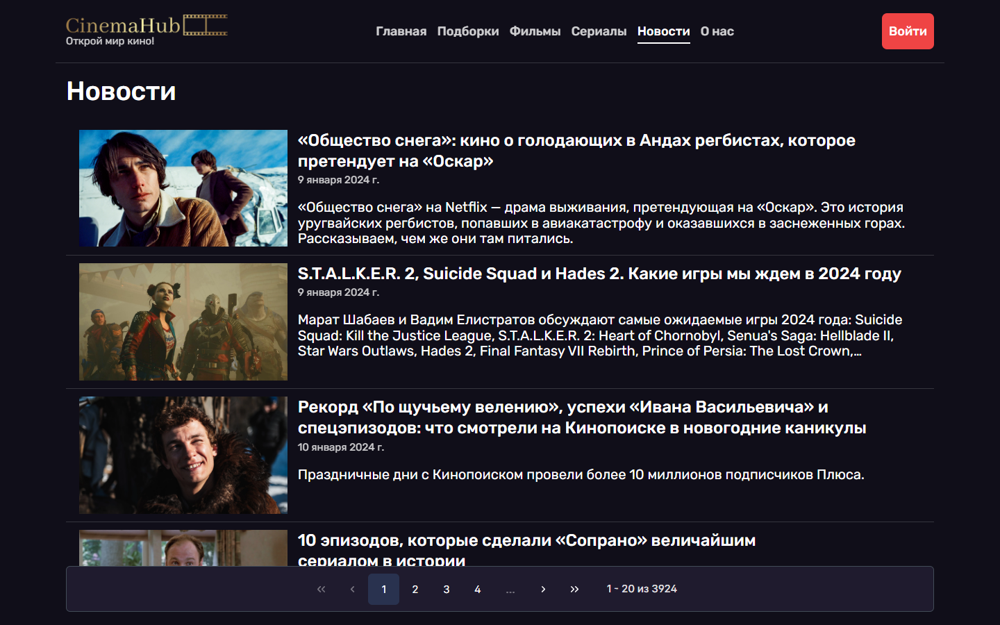 |
| Готовые коллекции: «250 лучших фильмов», «Фильмы про вампиров» и другие | Лента материалов Kinopoisk Media |

**Карточка фильма целиком** — описание, актёры и создатели, похожие фильмы и рецензии зрителей:

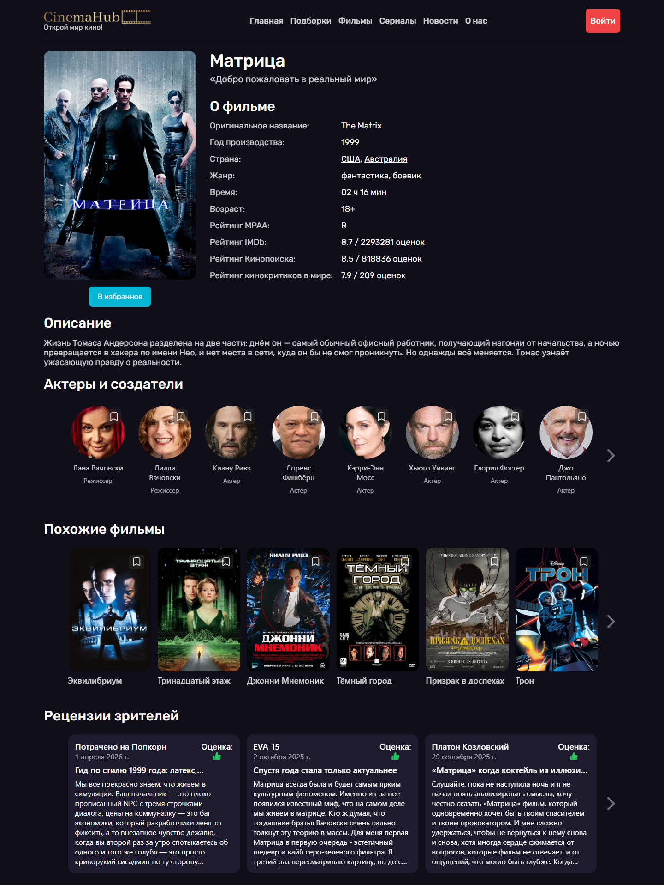

**Мобильная версия:**

| Главная | Каталог | Фильм |
| :---: | :---: | :---: |
| 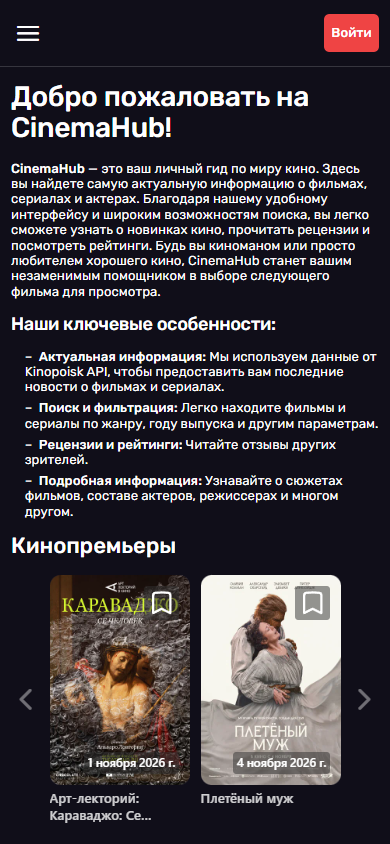 | 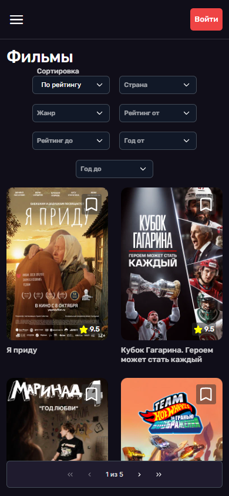 | 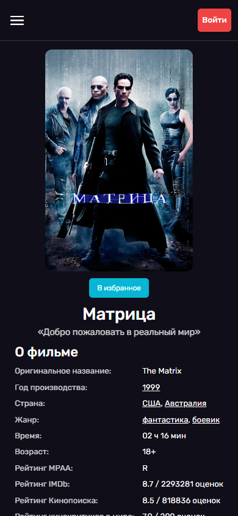 |

> Полный набор скриншотов — включая планшетную версию, каталог сериалов и страницу «О нас» — лежит в каталоге [`docs/screenshots`](docs/screenshots).

---

## Функциональность

### Главная страница
- Карусели «Кинопремьеры», «Популярные фильмы» и «Популярные сериалы» с постерами и рейтингами.
- Блок с описанием проекта и его возможностей.

### Каталог
- Разделы: фильмы, сериалы, мини-сериалы и ТВ-шоу — с разным набором фильтров.
- Фильтры: сортировка (по рейтингу, оценкам, году), страна, жанр, рейтинг «от» и «до», год «от» и «до».
- Для кинопремьер — выбор года и месяца.
- Пагинация по 20 карточек; при переключении страниц предыдущие данные остаются на экране до загрузки новых.
- Скелетоны на время загрузки фильтров и карточек.

### Страница фильма
- Постер, оригинальное и русское название, слоган.
- Год, страна, жанры, хронометраж, возрастной рейтинг, рейтинги Кинопоиска, IMDb и кинокритиков.
- Описание сюжета, актёры и создатели, трейлеры и клипы, похожие фильмы.
- Рецензии зрителей с оценками и пагинацией.
- Добавление фильма в избранное.

### Страница персоны
- Карьера, рост, дата и место рождения, количество наград, супруг(а).
- Фильмография с указанием роли и возможностью добавить персону в избранное.

### Подборки
- 12 готовых коллекций: «Популярные фильмы», «250 лучших сериалов», «Фильмы про зомби», «Мультфильмы» и другие.
- У каждой подборки — обложка и собственный список карточек с пагинацией.

### Новости
- Лента материалов Kinopoisk Media с обложками, датами и анонсами, с пагинацией.

### Аккаунт
- Регистрация и вход с валидацией полей (email, пароль, телефон в формате `(999) 999-9999`).
- Профиль пользователя, выход и удаление аккаунта с подтверждением.
- Статус API-ключа: тип доступа, суточный лимит и количество израсходованных запросов.
- Избранное в двух вкладках — фильмы и персоны.

---

## Технологии

| Слой | Технологии |
| --- | --- |
| Основа | React 18, TypeScript 5, Vite 5 |
| Маршрутизация | React Router 6 (lazy-страницы, `ScrollRestoration`) |
| Данные | TanStack Query 5, Axios, Kinopoisk API Unofficial |
| Состояние | Zustand 5 (фильтры, избранное), React Context (авторизация, тосты, тултипы, детали) |
| Формы | React Hook Form |
| UI | PrimeReact 10, Ant Design 5 (карусель), PrimeFlex, SCSS |
| Инструменты | ESLint, Prettier, `@trivago/prettier-plugin-sort-imports` |

---

## Архитектура

### Структура проекта

```text
src/
├── api/            # axios-клиент, работа с cookie и localStorage
├── assets/         # стили, шрифты, изображения, логотипы
├── components/     # компоненты страниц: карточки, фильтры, карусели, новости
├── config/         # настройки PrimeReact
├── constants/      # маршруты, фильтры, запросы, коды ошибок
├── context/        # провайдеры и хуки контекстов
├── helpers/        # чистые функции: фильтры, даты, избранное, ошибки
├── hooks/          # useDisplayMode, useFavorite, useOutsideClick и др.
├── layouts/        # каркас страниц и переиспользуемые раскладки
├── pages/          # Home, Gallery, Film, Person, Collections, News, About, Profile
├── queries/        # хуки TanStack Query
├── services/       # запросы к API и работа с пользователем
├── store/          # Zustand-сторы
├── ui/             # базовые элементы: Button, Modal, Paginator, Carousel, VideoPlayer
└── @types/         # типы приложения
```

### Решения, которые стоит отметить

- **Слои и переиспользование.** Базовые элементы (`ui`), раскладки (`layouts`) и компоненты страниц (`components`) разделены: например, карточка фильма используется и в каталоге, и в каруселях, и в избранном.
- **Кэширование и пагинация.** TanStack Query кэширует ответы по ключу `[filters, page]`, а `keepPreviousData` не даёт списку «прыгать» при переключении страниц. Запросы отменяются через `AbortSignal`, если пользователь ушёл со страницы.
- **Единый источник фильтров.** Zustand-стор хранит выбранные фильтры и текущую страницу; панель фильтров и запрос читают одно и то же состояние, поэтому сброс и смена направления не рассинхронизируются.
- **Ошибки.** На уровне маршрутов работает `ErrorBoundary`: он показывает код и текст ошибки, а при превышении суточного лимита API (402) — предупреждение и переводит в профиль со статусом ключа.
- **Загрузка.** Вместо спиннеров — скелетоны карточек, деталей и элементов фильтров; сами страницы подгружаются лениво.
- **Адаптивность.** Три режима (`desktop` / `tablet` / `mobile`) определяются по ширине окна и используются в разметке и стилях; на мобильных появляется бургер-меню.
- **Демо-авторизация.** Пользователи хранятся в localStorage, идентификатор сессии — в cookie; это позволяет пройти весь сценарий регистрации и избранного без бэкенда.

---

## Запуск

### Требования
- Node.js 18+
- npm

### Настройка

1. Получите API-ключ на [kinopoiskapiunofficial.tech](https://kinopoiskapiunofficial.tech) — подойдёт бесплатный тариф «Базовый доступ» (500 запросов в сутки).
2. Создайте в корне проекта файл `.env`:

   ```env
   VITE_API_KEY=ваш_ключ
   ```

3. Установите зависимости и запустите dev-сервер:

   ```bash
   npm ci
   npm run dev
   ```

   Приложение откроется на `http://localhost:3000`.

### Скрипты

| Команда | Что делает |
| --- | --- |
| `npm run dev` | Запускает dev-сервер Vite |
| `npm run build:dev` | Сборка в режиме development |
| `npm run build:prod` | Проверка типов и production-сборка в `dist` |
| `npm run preview` | Локальный просмотр собранной версии |
| `npm run lint` | ESLint без предупреждений |

> Ключ API попадает в клиентский бандл — это нормально для демо-проекта на публичном API, но не для продакшена. В реальном приложении запросы к API стоит проксировать через свой сервер.

---

## Ограничения и планы

- Поиск по названию не реализован — каталог работает через фильтры Kinopoisk API. Текстовый поиск — в планах.
- Авторизация и избранное хранятся только в браузере: данные не синхронизируются между устройствами.
- Бесплатный тариф API ограничен 500 запросами в сутки, часть подборок может быть недоступна.
- Тема оформления одна — тёмная; светлая тема в планах.

---

## Автор

**Алексей Баренков** — фронтенд-разработчик

- GitHub: [AlekseiBarenkov](https://github.com/AlekseiBarenkov)
- Email: [barenkov_aleksei@mail.ru](mailto:barenkov_aleksei@mail.ru)

Если проект оказался полезен или интересен — поставьте ⭐ репозиторию.
